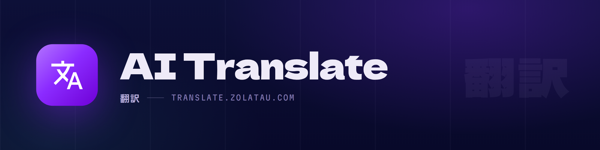

<p align="center">
  
</p>

<p align="center">
  <a href="README.de.md">🇩🇪&nbsp;Deutsch</a> ·
  <a href="../README.md">🇬🇧&nbsp;English</a> ·
  <a href="README.es.md">🇪🇸&nbsp;Español</a> ·
  <a href="README.fr.md">🇫🇷&nbsp;Français</a> ·
  <a href="README.id.md">🇮🇩&nbsp;Bahasa Indonesia</a> ·
  <a href="README.pt.md">🇧🇷&nbsp;Português</a> ·
  <b>🇷🇴&nbsp;Română</b> ·
  <a href="README.ru.md">🇷🇺&nbsp;Русский</a> ·
  <a href="README.uk.md">🇺🇦&nbsp;Українська</a> ·
  <a href="README.tr.md">🇹🇷&nbsp;Türkçe</a> ·
  <a href="README.vi.md">🇻🇳&nbsp;Tiếng Việt</a> ·
  <a href="README.ar.md">🇸🇦&nbsp;العربية</a> ·
  <a href="README.th.md">🇹🇭&nbsp;ไทย</a> ·
  <a href="README.ja.md">🇯🇵&nbsp;日本語</a> ·
  <a href="README.ko.md">🇰🇷&nbsp;한국어</a> ·
  <a href="README.zh.md">🇨🇳&nbsp;中文</a>
</p>

# AI Translate

Un plugin pentru Discord care îți traduce mesajele cu modelul de inteligență
artificială pe care îl alegi, fără să-ți netezească felul în care scrii.

Mesajele pe care le trimiți sunt traduse înainte să plece, conversație cu
conversație. Mesajele pe care le primești sunt traduse când ceri tu, din meniul
de clic dreapta.

## De ce încă un traducător

Traducerea automată e făcută pentru proză. Conversația nu e proză. Merge cu
litere mici și fraze neterminate, se ține pe kaomoji, iar un punct care lipsește
spune ceva. Majoritatea traducătorilor fac ordine în toate astea pe tăcute, iar
de partea cealaltă ajunge o scrisoare tip scrisă de altcineva.

Acesta e făcut ca să nu se atingă de nimic. Nu pune semne de punctuație pe care
nu le-ai scris, nu trece cu majusculă ce ai lăsat cu literă mică, îți păstrează
rândurile rupte acolo unde le-ai rupt și știe că un emoticon e o față, nu un
cuvânt de tradus.

## Ce știe să facă

Traducerea automată se pornește pentru fiecare conversație în parte, așa că
lucrează doar acolo unde chiar ai nevoie de ea. Clic stânga pe butonul de
traducere din bara de scriere deschide panoul, clic dreapta pornește sau
oprește conversația curentă.

Orice mesaj primit poate fi tradus din meniul de clic dreapta. Când nici
traducerea nu te lămurește, din cauza prescurtărilor, a unui cuvânt folosit
doar într-o țară sau a unei glume între doi oameni, **AI Explain** din același
meniu spune ce limbă e, desface prescurtările și zice ce s-a vrut.

Ultimele mesaje ale conversației pleacă odată cu fiecare cerere, așa că un
simplu „da” sau „nu se lipește” ajunge așa cum trebuia. Îți poți fixa și
vocabularul tău: cuvinte care nu se traduc niciodată, termeni legați de o
traducere fixă, genul gramatical pe care să-l folosească pentru tine și dacă i
se vorbește celuilalt formal sau nu.

Și un singur mesaj poate păstra o parte din el. Pune un cuvânt sau o expresie
între două bare oblice inverse, `\carpe diem\`, și pleacă exact cum ai scris-o,
fără bare; o bară oblică inversă la începutul rândului păstrează tot rândul.
Codul dintre accente grave nu se traduce niciodată.

Sub mesajele tale trimise poate rămâne originalul, vizibil doar pentru tine, ca
să vezi ce a plecat de fapt; acela e oprit până îl pornești tu. Interfața
vorbește 16 limbi și o urmează pe cea a Discordului cât timp nu îi spui altceva.

## Furnizori

Cheia de API o aduci tu și rămâne a ta. Pluginul nu are server propriu și nu
vede niciodată cheia nimănui.

| Furnizor | Plan gratuit |
|---|---|
| Groq | da |
| Google Gemini | da |
| Z.ai GLM | da, și merge acolo unde celelalte două sunt blocate |
| Anthropic Claude | nu |
| Orice API compatibil cu OpenAI | depinde de furnizor |

Poți pune un al doilea furnizor ca rezervă. Când primul e aglomerat, a rămas
fără cotă sau refuză cererea, traducerea trece prin celălalt fără să te
deranjeze cu asta.

Cererile pleacă din procesul de fundal al Discordului, așa că cheia ta nu ajunge
niciodată în partea de Discord la care ar putea ajunge o pagină web.

## Instalare

AI Translate merge în interiorul Vencord, un mod binecunoscut pentru aplicația
Discord. O singură comandă descarcă Vencord cu AI Translate deja înăuntru, cam
un megaoctet, și îl leagă de Discord. Pe calculatorul tău nu se compilează nimic
și nu mai trebuie instalat nimic altceva. Merge cu Discordul obișnuit, PTB și
Canary, pe Windows, macOS și Linux.

**Windows.** Deschide PowerShell (meniul Start, scrie „PowerShell”) și lipește:

```
irm https://builds.zolatau.com/install.ps1 | iex
```

**macOS și Linux.** Deschide Terminalul și lipește:

```
sh -c "$(curl -fsSL https://builds.zolatau.com/install.sh)"
```

Alege **Install or update** cu săgețile și apasă Enter. Când întreabă ce Discord
să lege, alege la fel pe cel pe care îl folosești. Pe Windows comanda închide
singură Discordul înainte să-l lege. Pe Linux s-ar putea să-ți ceară parola,
pentru că Discordul stă de obicei acolo unde doar un administrator poate scrie.
Apoi închide Discordul complet, inclusiv din iconița din bara de sistem, și
pornește-l din nou.

Pe sistemele Linux atomice, cum sunt Bazzite, Silverblue, Kinoite sau SteamOS,
merge aceeași comandă: nu instalează nimic în sistem, totul ajunge în
`~/.aiTranslate`. Discordul trebuie să fie cel din Flatpak, iar atunci
instalatorul îi dă singur acelui Flatpak acces la fișierele acelea. Un Discord
băgat în imaginea sistemului cu `rpm-ostree` de obicei nu poate fi legat, pentru
că dosarele de sistem sunt acolo doar pentru citire; instalează în loc versiunea
din Flatpak.

AI Translate e deja pornit. Deschide **Setări → Vencord → Plugins →
AI Translate**, alege un furnizor și lipește-ți cheia.

Tot ce descarcă comanda stă într-un dosar al lui:
`%LOCALAPPDATA%\aiTranslate` pe Windows și `~/.aiTranslate` pe macOS și Linux. A
lega Discordul înseamnă a-i schimba fișierul de pornire cu unul mic, care
încarcă întâi Vencord și apoi Discordul exact ca înainte; contul tău, setările
și mesajele nu sunt atinse.

## În browser

Discord într-o filă de browser nu are nevoie de nimic din cele de mai sus:
niciun Vencord de instalat, nimic de modificat. Același plugin, cu Vencord în
el, există și ca userscript.

Instalează [Tampermonkey](https://www.tampermonkey.net/) sau alt manager de
userscripturi, apoi deschide
[ai-translate.user.js](https://builds.zolatau.com/ai-translate.user.js).
Managerul îți propune să îl instaleze și de atunci îl ține la zi de acolo.
Deschide discord.com și reîncarcă pagina. Dacă ai extensia Vencord Web,
oprește-o: scriptul acesta are Vencord în el, iar două într-o filă nu se împacă.

Apoi deschide **Setări → Vencord → Plugins → AI Translate**, alege un furnizor
și lipește-ți cheia, la fel ca în aplicație. Cheia o ține managerul de
userscripturi, nu pagina, iar cererile pleacă tot prin el. Ca să îl scoți,
șterge scriptul din manager.

## Actualizări

Nu trebuie să faci nimic. AI Translate caută singur o versiune nouă o dată la 2
zile, o descarcă în fundal și arată o notificare; dă clic pe ea și Discordul
repornește deja în versiunea nouă. Dacă o ignori, actualizarea se aplică pur și
simplu data viitoare când pornești Discordul. **Verifică actualizările**, în
josul setărilor pluginului, face același lucru pe loc.

Fiecare versiune nouă aduce și cel mai recent Vencord, așa că și reparațiile lui
ajung pe același drum. Pe Windows și Linux legătura supraviețuiește și
actualizărilor Discordului. Dacă totuși AI Translate dispare după ce Discordul
s-a actualizat, rulează din nou comanda de instalare: repară instalarea fără
să-ți piardă setările.

## Cum se fac versiunile

Vencord rulează doar pluginurile care au fost compilate în el, așa că ce
descarci e Vencord cu AI Translate înăuntru. Nimeni nu le compilează de mână:
un robot pe GitHub verifică din oră în oră și, de îndată ce Vencord sau AI
Translate are o versiune nouă, le compilează pe amândouă din sursele lor și
publică rezultatul pe [builds.zolatau.com](https://builds.zolatau.com/), unde
sunt trecute sursele exacte din care a fost compilată fiecare versiune.

## Dezinstalare

Rulează aceeași comandă ca la instalare și alege **Remove**. Ia legătura de pe
Discord, așa că Discordul revine exact cum era, și apoi întreabă dacă să șteargă
și fișierele descărcate. Închide Discordul complet și pornește-l din nou.

Cheile de API și setările sunt ținute împreună cu setările Vencord, nu în
fișierele descărcate, așa că rămân acolo dacă vreodată îl instalezi din nou.

## Compilezi deja Vencord singur?

Din dosarul tău cu Vencord, clonează acest depozit înăuntru ca userplugin și
compilează din nou:

```
git clone https://github.com/mozumidesu/ai-translate src/userplugins/aiTranslate
pnpm build
```

Ambele rânduri sunt aceleași pe Windows, macOS și Linux, iar `git clone` creează
`src/userplugins` dacă nu există încă. Repornește Discordul după aceea. Cu
Equicord merge la fel. O copie compilată așa nu se actualizează singură de pe
GitHub; dă `git pull` și compilează din nou.

## Să spui ceva

Plicul din capul paginii de setări a pluginului deschide o fereastră pentru
raportat erori și cerut lucruri, cu capturi de ecran cu tot. Serverul de suport
e legat în aceeași fereastră.

## Licență

GPL-3.0-or-later.
